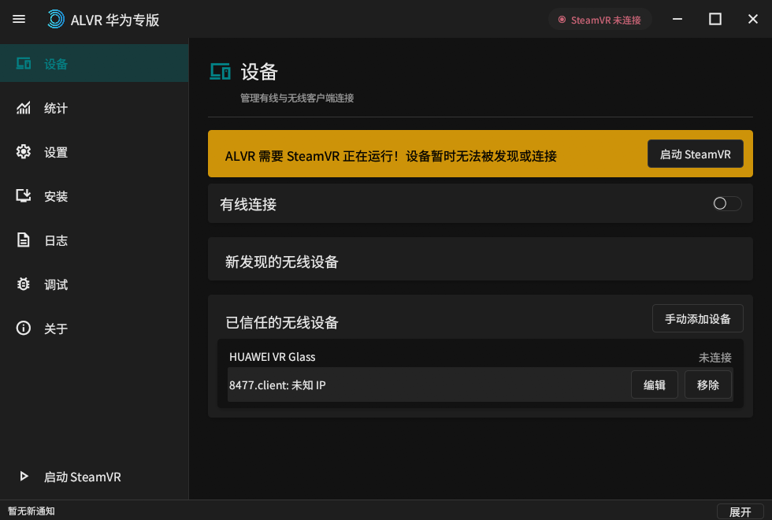
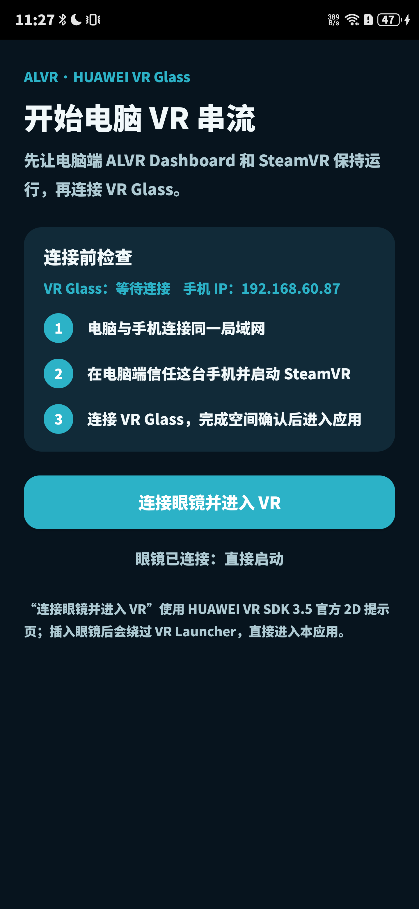
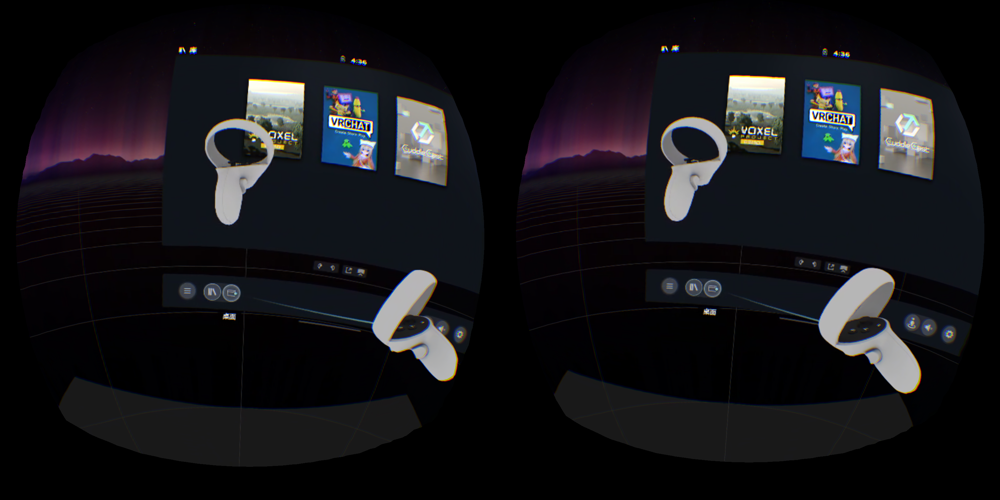
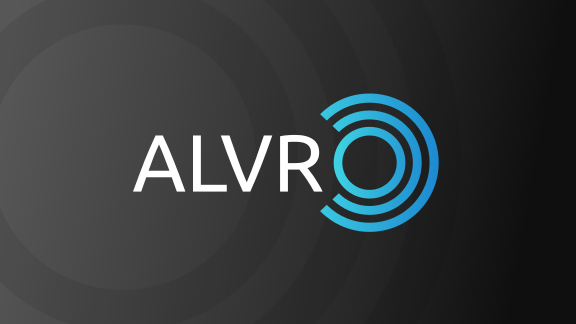

<p align="center"></p>

# Huawei VR Glass ALVR 专版

<p align="center"><strong>在 Huawei VR Glass 上通过局域网串流 SteamVR 的非官方 ALVR 魔改版本</strong></p>

<p align="center">
  <a href="https://github.com/LHT02/HuaweiVRGlass-ALVR/releases/latest"></a>
  <a href="LICENSE"></a>
</p>

> [!IMPORTANT]
> 本仓库是基于 [alvr-org/ALVR](https://github.com/alvr-org/ALVR) v20.14.1 开发的独立非官方专版，不是华为、SteamVR 或 ALVR 官方发行版。它面向连接 Huawei VR Glass 的华为手机和旧版 Huawei VR OpenXR Runtime；普通 Quest、Pico 等设备请优先使用 ALVR 上游版本。

## 下载

当前稳定版：**Huawei VR Glass ALVR v0.5.0**

| 平台 | 下载 | SHA-256 |
| --- | --- | --- |
| Android / HarmonyOS 手机端 | [HuaweiVRGlass-ALVR-Android-v0.5.0.apk](https://github.com/LHT02/HuaweiVRGlass-ALVR/releases/download/huawei-vr-glass-v0.5.0/HuaweiVRGlass-ALVR-Android-v0.5.0.apk) | `EA8EA7DFE02D34B25AADACC13E456844E25BAD4528806FC8CBFF0853F22574DA` |
| Windows PC 串流端 | [HuaweiVRGlass-ALVR-Windows-v0.5.0.zip](https://github.com/LHT02/HuaweiVRGlass-ALVR/releases/download/huawei-vr-glass-v0.5.0/HuaweiVRGlass-ALVR-Windows-v0.5.0.zip) | `E56CC847B00B9BF5E81C9EC47586A5A3F49C74BFF7252203B759A7EE8D4E5540` |

[查看完整发行说明和全部历史版本](https://github.com/LHT02/HuaweiVRGlass-ALVR/releases)

## 项目说明

本专版让 Huawei VR Glass 通过华为手机运行 ALVR Android 客户端，再将 PC 上的 SteamVR 画面、头部姿态、双手柄输入和音频在局域网内传输到眼镜。它保留 ALVR 的 SteamVR 驱动和网络协议，同时针对华为旧 Runtime、HiSilicon 解码器、眼镜光学方向和 6DoF 手柄做了独立适配。

主要改动包括：

- 接入 Huawei VR SDK Service、旧版 OpenXR Loader、Huawei VR Launcher 和专用 VR Activity。
- 支持 Huawei VR Glass 双眼 70 Hz 显示、原生 95°×95° FOV、63 mm IPD 和 1552×1552/眼 Runtime 推荐分辨率。
- 支持左右 6DoF 手柄独立姿态、按键、扳机和握把；Huawei 摇杆会从 0～1、中心 0.5 归一化到 -1～1，修正 Y 方向并应用圆形死区。
- 启用 HiSilicon `OMX.hisi.video.decoder.avc` H.264 硬件解码，并保留软件解码回退路径。
- 修复 HiSilicon Surface 时间戳与 ALVR Pose 队列不同步造成的重投影方向错误、裁剪和抖动。
- 修复华为显示链路的 Y 轴镜像、双眼物理方向和通用 ALVR 扩张 FOV 导致的偏广角问题。
- 解码器暂时没有新图像时保留上一张完整帧，减少间歇蓝屏和空白闪烁。
- 返回 Glass Home 后停止串流并退出 ALVR 进程。
- PC Dashboard 完整简体中文化，采用可折叠抽屉、自绘标题栏、Material Design 2 明暗主题和 Material Symbols Sharp 图标。
- 手机入口、VR 等待界面、Huawei VR Launcher/商店双层图标均已适配；普通 Android 桌面图标保持不变。
- 放宽专版客户端和服务端的 ALVR 版本字符串限制；真实协议反序列化错误仍会被拒绝并记录。
- 请求 Android 存储权限，使 Huawei VR 系统截图能够保存。

## 界面与真机截图

### 中文 PC Dashboard

<p align="center"></p>

### 当前设备手机端入口

下图由当前连接的 HUAWEI LYA-AL00 真机屏幕直接截取，不是设计稿或模拟器渲染。

<p align="center"></p>

### SteamVR 双眼串流与双手柄

原始外接显示捕获中左右眼各旋转 90°；为便于在普通显示器和 README 中查看，下图仅对两块眼图分别做了无损 90° 旋转，没有镜像、交换左右眼或重绘内容。

<p align="center"></p>

### Huawei VR Launcher/商店双层图标

背景来自 ALVR 官方 `BG-Gray.svg`，前景来自官方横版 `ALVR-White.svg`；两层由 Huawei VR Launcher 进行景深和位移合成。

<p align="center"></p>

## 已验证环境

| 项目 | 已验证值 |
| --- | --- |
| 手机 | HUAWEI LYA-AL00 |
| 手机系统 | HarmonyOS 4.2，Android 10 / API 29 基础 |
| 眼镜 | HUAWEI GLASS CV10 / Huawei VR Glass |
| 手柄 | Huawei 6DoF Gaming Kit，左右手独立追踪 |
| Huawei VR SDK | OpenXR SDK 3.5.0.79；真机 SDK Service 3.5.0.82 |
| 眼镜显示 | 3200×1600 总分辨率，70 Hz |
| Runtime 视图 | 1552×1552/眼，95°×95° 对称 FOV，63 mm IPD |
| Android 构建 | ARMv7 Release，min SDK 26，compile SDK 34，Huawei 兼容 target SDK 28 |
| PC 端 | Windows 10/11 x64，SteamVR |
| 网络 | PC 有线接路由器，手机使用同一局域网的 5 GHz Wi-Fi；TCP 档已验证 |

其他华为手机、系统版本、VR Runtime 或 6DoF 套装可能可以运行，但目前不能视为已验证兼容。

## 快速安装

### 1. 安装 PC 串流端

1. 下载并完整解压 Windows ZIP，不要直接在压缩包内运行。
2. 启动 `ALVR Dashboard.exe`。
3. 在“安装”页注册 SteamVR 驱动；若已有错误或旧版 ALVR 驱动，先在同一页面移除后再注册。
4. 启动 SteamVR。首次启动可能需要重新打开 Dashboard。

### 2. 安装 Android 客户端

可以在手机上手动打开 APK 安装，也可以使用 ADB：

```powershell
adb install -r .\HuaweiVRGlass-ALVR-Android-v0.5.0.apk
```

当前真机上，Huawei VR Glass 占用 USB-C 后，系统安装确认页可能只显示在手机屏幕且无法从眼镜中操作。建议先拔下眼镜完成安装和存储权限授权，再重新连接眼镜。

GitHub APK 是经过 Release 优化的旁加载构建，不是 Huawei 应用市场正式签名包。准备商店发行时必须换用自己的正式签名并重新核对 Huawei SDK 再分发许可。

### 3. 连接与首次进入

1. 让 PC 和手机连接同一局域网；推荐 PC 使用网线、手机使用 5 GHz Wi-Fi。
2. 保持 ALVR Dashboard 和 SteamVR 运行。
3. 在 Dashboard 的“设备”页信任手机。
4. 手机端点击“连接眼镜并进入 VR”，再连接 Huawei VR Glass。
5. 按 Huawei VR Launcher 提示完成空间确认，从 Glass Home 手动进入本应用。
6. 连接成功后，SteamVR 应同时出现头显和两只控制器。

不要通过 ADB 强制启动 VR Activity。该方式可能把手机 2D 界面投到眼镜显示；安装后应由用户从 Glass Home 手动打开。

## 华为专版默认串流配置

`main` 分支的新会话和华为一键配置脚本以眼镜 Runtime 推荐视图的 `1.0×` 比例为默认目标：

| 设置 | 默认值 |
| --- | --- |
| 编解码单眼分辨率 | Runtime 推荐值 `1.0×`；当前设备编码对齐后为 1536×1536 |
| SteamVR 模拟头显单眼分辨率 | Runtime 推荐值 `1.0×`；当前设备对齐后为 1536×1536 |
| 首选刷新率 | 72 Hz；Huawei Runtime 当前只提供 70 Hz，连接时会选择最接近的 70 Hz |
| 编解码器 | H.264，优先 HiSilicon 硬解 |
| 码率 | 14 Mbps 起步；画面压缩明显时可适当提高 |
| 网络协议 | TCP |
| 客户端缓冲 | 1 帧 |
| PC 待发送队列 | 1 帧 |
| 固定注视点编码 | 关闭 |

> v0.5.0 的新会话与重置配置使用上述比例默认值；从旧版本升级时，Windows 构建会保留现有 `session.json`。需要立即切换可运行包内的 `应用华为已验收配置.ps1`。比例模式以客户端通过 OpenXR 上报的推荐单眼视图为基准，并向下对齐到 32 像素倍数，而不是直接采用物理面板尺寸。性能不足时，可把“编解码单眼分辨率”改为已佩戴验收的绝对 896×896 低延迟档，模拟头显分辨率继续使用 `1.0×`。

当前设备上报 1552×1552/眼，ALVR 向下进行 32 像素对齐，因此 `1.0×` 的实际协商结果正是此前已经正常串流的 1536×1536/眼。72 Hz 是 PC 端首选值；Huawei 客户端仍会把硬件可用的 70 Hz 回报给服务端。

修改分辨率、刷新率、编解码器或模拟头显参数后，需要重启 SteamVR 才会完全生效。

## 常见问题

| 现象 | 检查与处理 |
| --- | --- |
| Dashboard 发现不了手机 | 确认同一局域网、Windows 防火墙规则、SteamVR 正在运行，并尝试在设备页手动添加手机 IP。 |
| 新旧客户端提示版本不匹配 | 专版已放宽版本字符串检查，但协议结构真正不兼容时仍不能连接；尽量使用同一发行版的 APK 和 PC 包。 |
| 安装一直阻塞 | 拔下 VR Glass，在手机屏幕完成安装确认和权限授权，再连接眼镜。 |
| 眼镜黑屏 | 先确认 Huawei VR SDK Service、VR Launcher 和数据线固件正常；从 Glass Home 手动启动，不要通过 ADB 直接启动 VR Activity。 |
| 间歇蓝屏或花屏 | 使用 H.264，关闭固定注视点编码；确认没有强制切换到不兼容的解码器，并降低码率或分辨率排查网络丢帧。 |
| 画面固定在空间、头转但画面不跟 | 确认使用包含 HiSilicon 时间戳重同步修复的 v0.4.0 或更新版本；不要混用旧 APK。 |
| 画面偏广角或斜看物体变形 | 确认客户端上报 Huawei 原始 95° FOV，SteamVR 中不要遗留旧版驱动配置。 |
| 只有一只手柄有空间位置 | 使用专版 Huawei OpenXR Pose Action；重新连接两只手柄并重新完成空间确认。 |
| 摇杆静置仍有输入 | 新版已按 Huawei 的 0.5 中心归一化并加入 0.12 圆形死区；手机恢复供电后需分别实测双手静置和四个方向。实现与验证边界见 [华为端技术说明](HUAWEI_VR_GLASS.md)。 |
| 返回 Home 后进程仍运行 | v0.4.0 已在返回 Glass Home 时停止串流并退出；若仍复现，请记录 APK 版本和 `adb logcat`。 |
| 系统截图无法保存 | 在手机端授予存储权限；授权框不会在 VR Activity 内强弹。 |
| ADB 被眼镜占用 | 先用 USB 执行 `adb tcpip 5555` 并连接无线 ADB，再将 USB-C 切回 VR Glass。 |

## 从源码构建

详细环境、SDK 校验和脚本参数见 [`scripts/huawei/README.md`](scripts/huawei/README.md)。常用命令：

```powershell
pwsh -NoProfile -File .\scripts\huawei\build-android.ps1 -Configuration Release -SkipToolInstall
pwsh -NoProfile -File .\scripts\huawei\build-windows.ps1 -Configuration Release
```

构建脚本从仓库外的 SDK 目录读取已校验 Huawei OpenXR Loader、`hvrbridge.jar`、`hvrprompt.aar` 和真机 Runtime 兼容库。华为官方 SDK 原始包、签名文件、构建产物、设备日志和本机 `session.json` 不应提交到 Git。

Windows 构建默认使用 `--keep-config` 保留现有 ALVR 配置。若要有意恢复当前源码默认值，可传入 `-ResetConfiguration`；打包后的 `应用华为已验收配置.ps1` 可以向正在运行的 Dashboard 写入华为推荐档。

## 上游 ALVR 原说明的中文翻译

以下内容是原 README 中通用 ALVR 说明的中文化整理。它描述上游 ALVR 生态，不代表本魔改 APK 已在所有设备上验证。

### 上游头显兼容性

| VR 头显 | 上游支持状态 |
| --- | --- |
| Apple Vision Pro | 支持，[商店链接](https://apps.apple.com/app/alvr/id6479728026) |
| Quest 1/2/3/3S/Pro | 支持，[商店链接](https://www.meta.com/experiences/7674846229245715)；Quest 1 不提供 Meta 商店版本 |
| Pico Neo 3/4/4 Ultra | 支持 |
| Play For Dream YVR 1/2/MR | 支持 |
| Vive Focus 3/Vision/XR Elite | 支持 |
| Lynx R1 | 支持 |
| PhoneVR（智能手机） | 部分设备支持，[项目仓库](https://github.com/PhoneVR-Developers/PhoneVR) |
| Android/Monado | 实验性支持，仅在部分设备上工作 |
| Oculus Go | 不再支持，[旧项目](https://github.com/polygraphene/ALVR) |

### 上游 PC 系统兼容性

| PC 系统 | 上游支持状态 |
| --- | --- |
| Windows 10/11 | 支持，[Steam 商店](https://store.steampowered.com/app/3312710) |
| Windows XP/7/8 | 不支持 |
| Linux | Beta；音频、运行和源码构建可能需要较强的发行版调试经验 |
| macOS | 不支持 |

### 上游通用要求

- 一台受支持的独立 VR 头显。
- SteamVR。
- 性能足够的游戏 PC。
  - NVIDIA GPU 需要支持 NVENC，通常为 GTX 1000 系列或更新，并安装较新的驱动。
  - AMD GPU 需要支持 AMF/VCE。
  - 同时存在核显和独显的笔记本，应在系统或显卡控制面板中把 ALVR、SteamVR 和 VR 游戏指定为高性能独显。
- 802.11ac 5 GHz Wi-Fi 或有线网络。
  - 推荐头显连接 5 GHz Wi-Fi，PC 通过网线连接路由器。
  - PC 和头显必须位于同一可路由网络。高级组网见 [ALVR v14 及以上网络说明](https://github.com/alvr-org/ALVR/wiki/ALVR-v14-and-Above)。

### 上游安装、排错与卸载

- 通用安装流程见 [ALVR Installation guide](https://github.com/alvr-org/ALVR/wiki/Installation-guide)。华为专版应优先使用本 README 前面的专用流程。
- 通用问题见 [Troubleshooting](https://github.com/alvr-org/ALVR/wiki/Troubleshooting)；Linux 另见 [Linux Troubleshooting](https://github.com/alvr-org/ALVR/wiki/Linux-Troubleshooting)。
- 配置建议见 [Information and Recommendations](https://github.com/alvr-org/ALVR/wiki/Information-and-Recommendations)。
- 卸载时，打开 `ALVR Dashboard.exe`，在“安装”页移除防火墙规则和 SteamVR 驱动，然后关闭 ALVR 并删除解压目录。
- 上游源码构建说明见 [Building From Source](https://github.com/alvr-org/ALVR/wiki/Building-From-Source)。华为专版必须额外使用本仓库脚本和官方 SDK。

## 许可、隐私与上游社区

- ALVR 及本仓库可公开部分使用 [MIT License](LICENSE)。
- ALVR 应用本身不直接收集用户数据。
- Huawei SDK、Runtime 文件和商店签名可能受额外许可约束；公开或商业再分发前请自行核对华为条款。
- 上游社区：[Discord](https://discord.gg/ALVR) · [Matrix](https://matrix.to/#/#alvr:ckie.dev?via=ckie.dev) · [Open Source Collective](https://opencollective.com/alvr)
- 如需支持 ALVR 上游，可向 [Open Source Collective](https://opencollective.com/alvr) 捐赠；原 README 也列出原作者 PayPal `polygraphene@gmail.com` 和比特币地址 `1FCbmFVSjsmpnAj6oLx2EhnzQzzhyxTLEv`。本魔改仓库不代表上游接受或背书本专版。

更深入的 Huawei Runtime、渲染、解码、控制器和调试说明见 [`HUAWEI_VR_GLASS.md`](HUAWEI_VR_GLASS.md)。
